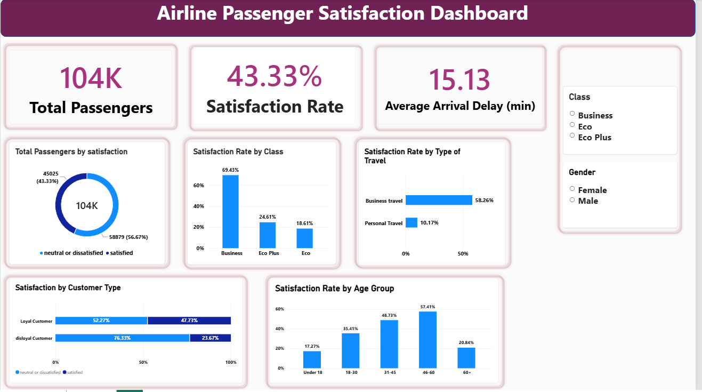

# Airline Passenger Satisfaction Analysis and Prediction

This project combines Python data cleaning, exploratory analysis, machine learning, and an interactive Power BI dashboard to explore airline passenger satisfaction. It uses 103,904 survey records from `train.csv` to compare customer segments and predict whether a passenger is satisfied or neutral/dissatisfied.

## Dashboard preview



## Project objectives

- Prepare a clean dataset for analysis and Power BI reporting.
- Explore satisfaction by travel class, customer type, travel purpose, age, and gender.
- Compare service ratings and arrival delays across satisfaction groups.
- Train and compare Logistic Regression and Random Forest classifiers.
- Present the findings through an interactive Power BI report.

## Tools used

- Python and Jupyter Notebook / Google Colab
- pandas and NumPy for data preparation
- Matplotlib for exploratory charts
- scikit-learn for preprocessing, classification, and evaluation
- Microsoft Power BI Desktop and DAX for the dashboard

## Repository files

| File | Purpose |
|---|---|
| `train.csv` | Original dataset used for cleaning, analysis, and the internal training/evaluation split |
| `airline_passenger_cleaned.ipynb` | Notebook containing cleaning, exploratory analysis, model training, evaluation, and CSV exports |
| `airline_passenger_cleaned.csv` | Cleaned dataset used in Power BI |
| `feature_importance.csv` | Random Forest importance scores for the encoded model features |
| `Airline Passenger Satisfaction Analysis and Prediction.pbix` | Completed Power BI report |
| `dashboard.png` | Dashboard screenshot displayed above |
| `README.md` | Project overview and usage instructions |

The separately supplied `test.csv` is not used by the current notebook. Model results below come from a split of `train.csv`, rather than evaluation on that separate file.

## Data preparation

The notebook:

1. Loads `train.csv` and checks dimensions, data types, missing values, and duplicate rows.
2. Removes the index column `Unnamed: 0` and passenger identifier `id`.
3. Fills 310 missing values in `Arrival Delay in Minutes` with that column's median, which is **0 minutes** in this dataset.
4. Checks for duplicates and applies `drop_duplicates()`; no duplicate rows are found after the identifiers are removed.
5. Encodes satisfaction as 1 for `satisfied` and 0 for `neutral or dissatisfied`.
6. Creates five age groups and exports `airline_passenger_cleaned.csv`.

The cleaned dataset contains 103,904 rows and 25 columns, including the numeric satisfaction target and age group.

## Exploratory analysis

The notebook examines satisfaction distributions, passenger segments, average delays, service-rating averages, service-rating differences, and correlations with the numeric satisfaction target.

### Overall findings

| Metric | Value |
|---|---:|
| Passenger survey records | 103,904 |
| Satisfied records | 45,025 |
| Neutral or dissatisfied records | 58,879 |
| Satisfaction rate | 43.33% |
| Average arrival delay after median imputation | 15.13 minutes |

### Satisfaction by segment

| Segment | Satisfaction rate |
|---|---:|
| Business class | 69.43% |
| Eco Plus class | 24.61% |
| Eco class | 18.61% |
| Business travel | 58.26% |
| Personal travel | 10.17% |
| Loyal customers | 47.73% |
| Disloyal customers | 23.67% |

Business-class passengers, business travelers, and loyal customers show higher satisfaction rates than their comparison groups in this dataset. These associations do not establish causation.

## Machine learning

### Preprocessing and evaluation

The notebook removes both satisfaction columns from the predictors. It scales numeric features with `StandardScaler` and encodes categorical features with `OneHotEncoder(handle_unknown="ignore")` inside a scikit-learn pipeline.

The data is split with `test_size=0.20`, `random_state=42`, and stratification by the target:

- Training subset: **83,123 records**
- Evaluation subset: **20,781 records**

Logistic Regression uses `max_iter=1000`. Random Forest uses 200 trees, `random_state=42`, and `n_jobs=-1`.

### Recorded model results

These values are taken from the notebook's saved outputs; they have not been independently reproduced in this README revision.

| Model | Accuracy |
|---|---:|
| Logistic Regression | 87.71% |
| Random Forest | 96.30% |

Random Forest performs better on this evaluation split. Its recorded per-class metrics are:

| Class | Precision | Recall | F1-score | Support |
|---|---:|---:|---:|---:|
| Neutral/Dissatisfied | 0.96 | 0.98 | 0.97 | 11,776 |
| Satisfied | 0.97 | 0.95 | 0.96 | 9,005 |

### Random Forest feature importance

| Encoded feature | Importance |
|---|---:|
| Online boarding | 0.1378 |
| Inflight wifi service | 0.1339 |
| Class_Business | 0.0691 |
| Inflight entertainment | 0.0582 |
| Type of Travel_Business travel | 0.0574 |

The complete scores are exported to `feature_importance.csv`. They are impurity-based Random Forest importance scores, not causal effects or accuracy percentages. Categorical features are represented by separate one-hot encoded columns.

## Power BI dashboard

The completed single-page report includes:

- Total Passengers, Satisfaction Rate, and Average Arrival Delay KPI cards.
- A donut chart showing the satisfaction distribution.
- Satisfaction comparisons by class, travel purpose, customer type, and age group.
- Class and Gender slicers that filter the report interactively.

The predictive models run in the Python notebook. They are not integrated into the Power BI report.

### Core DAX measures

```DAX
Total Passengers =
COUNTROWS('airline_passenger_cleaned')

Satisfaction Rate =
AVERAGE('airline_passenger_cleaned'[satisfaction_numeric])

Average Arrival Delay =
AVERAGE('airline_passenger_cleaned'[Arrival Delay in Minutes])
```

Format `Satisfaction Rate` as a percentage. The age-group sorting column is derived from Age:

```DAX
Age Group Order =
SWITCH(
    TRUE(),
    'airline_passenger_cleaned'[Age] <= 18, 1,
    'airline_passenger_cleaned'[Age] <= 30, 2,
    'airline_passenger_cleaned'[Age] <= 45, 3,
    'airline_passenger_cleaned'[Age] <= 60, 4,
    5
)
```

Set `Age Group` to sort by `Age Group Order` and sort the visual ascending by Age Group.

## How to run the notebook

1. Download or clone the repository.
2. Install the required packages:

   ```bash
   pip install pandas numpy matplotlib scikit-learn jupyter
   ```

3. Keep `train.csv` in the notebook's working directory.
4. Open `airline_passenger_cleaned.ipynb` in Jupyter Notebook or upload it to Google Colab.
5. For local Jupyter use, skip the cell importing `google.colab` and mounting Google Drive. In Colab, make `train.csv` available in the working directory before running the first cell.
6. Run the remaining cells in order. The notebook trains both models and exports the cleaned dataset and feature importance CSV.

Package versions are not pinned in the supplied notebook, so results may vary between environments.

## How to open the dashboard

1. Download the `.pbix` file and open it in Microsoft Power BI Desktop.
2. Explore the report using the Class and Gender slicers.
3. Clear the slicers to return to the overall results.
4. To refresh from CSV, download `airline_passenger_cleaned.csv` and update its source path in Power Query before refreshing. The original local source path may not exist on another computer.

The imported report data is already stored inside the Power BI file.

## Limitations and future improvements

- Counts represent survey rows, rather than a deduplicated count of unique passengers.
- Neutral and dissatisfied responses are combined into one target class.
- Median imputation occurs before the train/evaluation split. A future version should fit the imputer on the training subset inside the pipeline to prevent evaluation data from influencing preprocessing.
- Filling missing arrival delays with zero affects the dashboard mean. The observed-value mean, excluding those missing values, is approximately 15.18 minutes.
- The existing age labels are imprecise: `Under 18` includes age 18, and `18-30` covers ages 19–30. More accurate labels are `18 and under`, `19-30`, `31-45`, `46-60`, and `61+`.
- Service-rating averages include zero ratings; their meaning should be checked against the source documentation.
- The data contains no date column for time-trend analysis.
- Model performance is reported for one internal split. Future work can add cross-validation and evaluation on the separately supplied `test.csv`.
- Feature importance can favor some predictors and should be supplemented with permutation importance on held-out data.

## Dataset source and attribution

The raw `train.csv` and `test.csv` files were downloaded from the [Datasets folder in ines-bettaieb/Airline-Passenger-Satisfaction](https://github.com/ines-bettaieb/Airline-Passenger-Satisfaction/tree/main/Datasets). Credit is given to the repository owner for making this copy available.

The source repository's [README](https://github.com/ines-bettaieb/Airline-Passenger-Satisfaction/blob/main/README.md) states that the dataset was obtained from Kaggle, but does not identify the specific Kaggle dataset page. No explicit dataset redistribution license was found in the repository root, its README, or the Datasets folder when checked on 10 October 2026. The supplied GitHub link establishes the download source; it does not establish the original creator or redistribution terms. No dataset license is asserted by this project.
